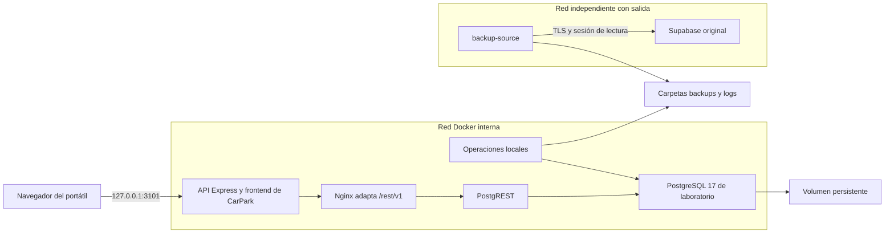

# Arquitectura del laboratorio

## Infraestructura encontrada

La rama `main` inspeccionada corresponde al commit `4a9fd3baebe33653d69a82cb085653c8c906b01d`. El frontend activo está en `CarPark-FUNCIONA/index.html`. `server.js` arranca Express y `src/app.js` define las rutas. `src/services/sitios.js` usa `@supabase/supabase-js` para consultar las plazas y sus zonas.

Vercel tiene un despliegue de producción `READY` para ese commit, con Node.js 24 y el dominio `car-park-snowy.vercel.app`. Aloja la web y la API. Las variables de producción observadas son `SUPABASE_URL` y `SUPABASE_PUBLISHABLE_KEY`. El proyecto de Supabase es `urkcwcqxointyliyhmow`, con PostgreSQL 17.11.

El catálogo tiene las tablas `ciudades`, `direcciones`, `zonas`, `plazas`, `dispositivos` e `historico_ocupacion`. Además existe `usuarios`, relacionado con `auth.users`, que se deja fuera del laboratorio. La dirección se almacena en `direcciones`; una función calculada mantiene la consulta `direccion` de la API publicada.

No se encontraron archivos Docker en `main`. El simulador de Marc está en el PR #54 y tiene una alternativa de Mosquitto con Docker, independiente de este laboratorio. La copia habitual de Alex contiene cambios de autenticación y de lectura de direcciones aún pendientes de publicar. Esta rama parte del código publicado y no incorpora esos cambios locales.

## Contenedores y redes

PostgREST permite utilizar la API existente sin instalar Supabase completo ni añadir otro controlador a Express. Nginx adapta el prefijo `/rest/v1` utilizado por el SDK a las rutas de PostgREST. La clave JWT del laboratorio se firma con un secreto local y solo autoriza el rol de lectura `anon`. No se configura Supabase Auth local.

La API tiene además una red puente para publicar el puerto de loopback. Docker Desktop no publicaba ese puerto cuando el contenedor solo tenía una red interna. Los contenedores que restauran y PostgreSQL permanecen exclusivamente en la red interna. La red de salida del exportador está separada de ambos.

`db` tiene un healthcheck de PostgreSQL. `api` comprueba `/api/sitios`, para verificar una consulta real, y se inicia después de cargar el catálogo. El mapa del navegador continúa necesitando acceso a las teselas de OpenStreetMap. Las copias y restauraciones de PostgreSQL son independientes del servicio de mapas.

## Formato y alcance de las copias

`pg_dump` crea un archivo custom con seis tablas permitidas. El formato conserva sus columnas, datos y restricciones incluidas por PostgreSQL. La selección por tabla no exporta todos los objetos de Supabase ni las funciones externas al catálogo. Tras restaurar se repone la función calculada `direccion` y se conceden permisos locales de lectura a los roles de laboratorio.

El manifiesto se obtiene del contenido del archivo de backup. Cada tabla incluye sus columnas, cantidad de filas y SHA-256 de sus filas COPY ordenadas. Así se evita comparar el dump con una consulta posterior del servidor que podría haber cambiado. La verificación exige seis claves foráneas y prueba una inserción inválida dentro de una transacción que se revierte.

La instantánea JSON obtenida con el conector es una vía distinta. Recupera los datos del catálogo sobre el modelo reducido del laboratorio, sin afirmar que se ha exportado todo el DDL del origen. Los resultados distinguen esa prueba inicial de la posterior copia remota real, que ya se ha ejecutado y restaurado. El rol remoto `lector` tiene políticas SELECT específicas para las seis tablas y lectura por defecto activada con autorización. En Docker se crea `lector` sin login para que se puedan reponer sus políticas.

## Fuentes oficiales

- [pg_dump de PostgreSQL 17](https://www.postgresql.org/docs/17/app-pgdump.html)
- [pg_restore de PostgreSQL 17](https://www.postgresql.org/docs/17/app-pgrestore.html)
- [Backups de Supabase](https://supabase.com/docs/guides/platform/backups)
- [Redes en Compose](https://docs.docker.com/compose/how-tos/networking/)
- [Secretos en Compose](https://docs.docker.com/compose/how-tos/use-secrets/)
- [Campos calculados de PostgREST](https://docs.postgrest.org/en/stable/references/api/computed_fields.html)
